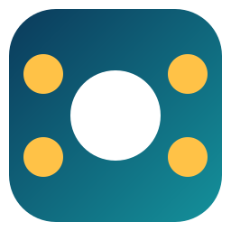
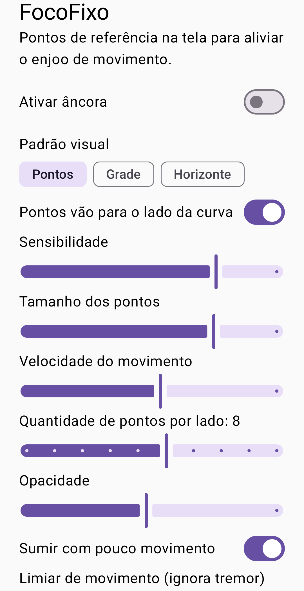
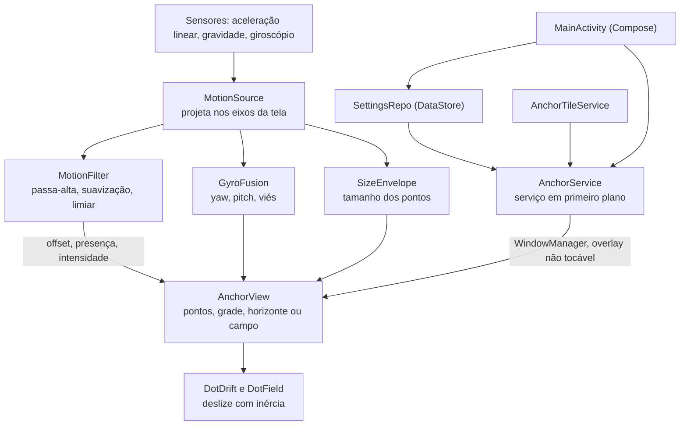

<div align="center">



# FocoFixo

*Âncora visual para Android que ajuda quem sente enjoo de movimento (cinetose) a usar o celular dentro de um veículo.*

</div>

<p align="center">
  
  
  
  
</p>

| | |
| --- | --- |
| **Versão** | 0.1 |
| **Estado** | Protótipo funcional: âncora, ajustes, atalho nas configurações rápidas e padrões visuais implementados; ainda sem validação em veículo |
| **Contexto** | Projeto pessoal, inspirado no recurso Vehicle Motion Cues do iOS |
| **Alvo** | Celulares Android 8.0 (API 26) ou superior |

> **Limite principal:** o FocoFixo não é dispositivo médico e não garante alívio da cinetose. A direção dos movimentos (acelerar, frear, curvas) foi verificada por testes unitários, mas ainda não calibrada em viagem real; por isso existe a chave **Pontos vão para o lado da curva**.

## Sumário

- [Início rápido](#início-rápido)
- [1. Objetivo](#1-objetivo)
- [2. Arquitetura](#2-arquitetura)
- [3. Estrutura do repositório](#3-estrutura-do-repositório)
- [4. Como a animação funciona](#4-como-a-animação-funciona)
- [5. Desenvolvimento e execução local](#5-desenvolvimento-e-execução-local)
- [6. Critérios de aceite](#6-critérios-de-aceite)
- [7. Limites de escopo e evolução](#7-limites-de-escopo-e-evolução)
- [8. Documentação complementar](#8-documentação-complementar)
- [9. Autor e licença](#9-autor-e-licença)

## Início rápido

```bash
git clone https://github.com/josemurilors/FocoFixo.git
cd FocoFixo
./gradlew testDebugUnitTest   # testes unitários
./gradlew installDebug        # instala no aparelho conectado por USB
```

Abra o app, conceda **Exibir sobre outros apps** e ative **Ativar âncora**.

<p align="center">
  
</p>

## 1. Objetivo

A cinetose surge do conflito entre o que os olhos veem (tela parada) e o que o ouvido interno sente (movimento do veículo). O FocoFixo desenha referências visuais nas bordas da tela, **sobre qualquer outro app**, que se movem conforme a aceleração medida pelos sensores do aparelho. A visão periférica acompanha o movimento do veículo enquanto o conteúdo central fica livre.

O app **não** coleta dados, não acessa a rede (não declara a permissão `INTERNET`) e não toma conta da tela: o desenho não captura toques, que passam para o app de baixo.

### Entregas da versão

- Âncora em overlay com serviço em primeiro plano e ação **Desligar** na notificação.
- Quatro padrões visuais: **Pontos**, **Grade** (réguas curtas nas laterais), **Horizonte** (linha que inclina com a curva) e **Campo** (grade hexagonal na tela inteira, com os pontos sumindo no centro).
- Pontos que crescem ao acelerar e frear, e curvas lidas também pelo giroscópio.
- Atalho (Quick Settings Tile) para ligar e desligar pela barra de configurações rápidas.
- Ajustes salvos no aparelho: padrão, lado da curva, sensibilidade, tamanho, velocidade, quantidade de pontos, opacidade, limiar de movimento, suavização, cor, taxa do sensor e sumir em repouso.

## 2. Arquitetura



**Fluxo:** a cada leitura do sensor, `MotionSource` entrega a aceleração já nos eixos da tela, `MotionFilter` a suaviza e devolve o deslocamento, e `AnchorView` redesenha. Os ajustes chegam ao serviço em tempo real por um `Flow`.

### Stack tecnológica

| Área | Escolha | Papel |
| --- | --- | --- |
| Linguagem | Kotlin 2.1 | Todo o código do app |
| Interface | Jetpack Compose + Material 3 | Tela de ajustes |
| Desenho | `View` com `Canvas` | Overlay de baixa latência |
| Persistência | DataStore Preferences | Guarda os ajustes |
| Build | Gradle 8.14 (wrapper), AGP 8.11 | Compilação e testes |
| Testes | JUnit 4 | Lógica pura (filtro, eixos, deslize) |

## 3. Estrutura do repositório

```text
FocoFixo/
├── app/
│   ├── src/main/java/com/focofixo/
│   │   ├── MainActivity.kt        # tela de ajustes (Compose)
│   │   ├── AnchorService.kt       # serviço em primeiro plano + overlay
│   │   ├── AnchorTileService.kt   # atalho nas configurações rápidas
│   │   ├── AnchorView.kt          # desenho dos quatro padrões
│   │   ├── MotionSource.kt        # leitura dos sensores
│   │   ├── ScreenAxes.kt          # projeção da aceleração na tela
│   │   ├── GyroFusion.kt          # yaw, pitch e viés do giroscópio
│   │   ├── MotionFilter.kt        # suavização, limiar, presença, intensidade
│   │   ├── DotDrift.kt            # deslize com inércia ao longo da borda
│   │   ├── DotField.kt            # campo hexagonal na tela inteira (modo Focus)
│   │   ├── SizeEnvelope.kt        # crescimento dos pontos ao acelerar e frear
│   │   └── Settings.kt            # ajustes e DataStore
│   ├── src/main/res/              # ícone adaptativo e ícone do atalho
│   └── src/test/java/com/focofixo/  # testes unitários
├── docs/                          # spec, plano e imagens
├── icons/                         # conjunto completo do ícone (Windows, macOS, Linux, web)
├── build.gradle.kts
└── README.md
```

## 4. Como a animação funciona

- **Projeção nos eixos da tela** (`ScreenAxes.kt`): a aceleração linear é decomposta em *lateral* (direita da tela) e *frente* (direção horizontal para onde a tela "olha para longe"), usando o vetor de gravidade e a rotação do display. Com o aparelho quase deitado, "frente" cai para o eixo "cima da tela".
- **Acelerar para a frente** faz os pontos descerem; frear os faz subir. A **curva** desloca os pontos para o lado oposto da força (ou para o mesmo lado, com a chave ligada).
- **Filtro** (`MotionFilter.kt`): uma média lenta (1 s) remove componentes constantes, como gravidade residual e curvas longas; uma suavização rápida elimina ruído. Movimento abaixo do **limiar** é ignorado.
- **Deslize com inércia** (`DotDrift.kt`): a aceleração vira velocidade com atrito de 1,2 s, e os pontos dão a volta na borda. Cada ponto tem um ganho entre 0,7 e 1,3, o que cria o efeito de paralaxe.
- **Presença e intensidade:** em repouso os pontos somem (2 s); movimento brusco acende mais pontos (metade fica sempre visível).
- **Giroscópio** (`GyroFusion.kt`): a taxa de giro é decomposta em *yaw* (em torno da vertical) e *pitch* (em torno do eixo lateral da tela). No padrão **Campo** ela rola a grade diretamente: virar para a esquerda faz os pontos irem para a direita, e inclinar o topo do aparelho para longe os faz descer. O viés do giroscópio é estimado enquanto o aparelho está parado, para o campo não derivar sozinho.
- **Campo** (`DotField.kt`): grade hexagonal que dá a volta nas bordas da tela; no modo *Focus* os pontos somem no centro e ficam inteiros nas bordas e cantos.
- **Tamanho** (`SizeEnvelope.kt`): a aceleração para frente ou para trás aumenta os pontos em até 2,5× e eles voltam ao normal em cerca de 1 s.
- **Toques:** a janela do overlay usa opacidade 0,79 no Android 12+, abaixo do limite de 0,8 acima do qual o sistema bloqueia toques que a atravessam.

| Ajuste | Faixa | Padrão |
| --- | --- | --- |
| Sensibilidade | 0 a 3 | 1 |
| Tamanho dos pontos | 6 a 32 dp | 14 dp |
| Velocidade do movimento | 0,2 a 2,5× | 1× |
| Pontos por lado | 3 a 12 | 6 |
| Opacidade | 0,1 a 1 | 0,6 |
| Limiar de movimento | 0 a 2 m/s² | 0,3 |
| Suavização | 0 a 1 | 0,175 |
| Taxa do sensor | 30, 60 ou 120 Hz | 60 Hz |

**Limitações:** nos padrões de borda o deslize contínuo é só vertical; o lateral é um deslocamento limitado. O campo não é nivelado ao mundo (não gira junto com o ângulo do aparelho). Com taxa de 120 Hz o consumo de bateria sobe.

## 5. Desenvolvimento e execução local

### Pré-requisitos

- JDK 17 ou superior
- Android SDK com a plataforma 35 (o Gradle localiza o SDK por `ANDROID_HOME` ou por `local.properties`, que não é versionado)
- Aparelho Android 8.0+ com depuração USB, ou emulador

### Passo a passo

1. Clone o repositório e entre na pasta.
2. Conecte o aparelho e confirme com `adb devices`.
3. Rode `./gradlew installDebug` e abra o FocoFixo.
4. Conceda **Exibir sobre outros apps** quando solicitado e ative a âncora.
5. Para o atalho: abra o editor da barra de configurações rápidas e arraste o bloco **FocoFixo**.

### Testes

```bash
./gradlew testDebugUnitTest
```

São 34 testes unitários sobre a lógica pura (`MotionFilter`, `ScreenAxes`, `GyroFusion`, `DotDrift`, `DotField`, `SizeEnvelope`). O desenho, o serviço e o atalho não têm testes automatizados e foram conferidos manualmente.

## 6. Critérios de aceite

- [x] O build `assembleDebug` compila e o app instala em aparelho Android.
- [x] Os 34 testes unitários passam.
- [x] A âncora aparece sobre outros apps e funciona no aparelho de desenvolvimento.
- [x] A aceleração é projetada nos eixos da tela, inclusive com o aparelho girado.
- [ ] Validação em veículo real da direção dos pontos (frente, trás e curvas) — pendente; hoje só há teste unitário.
- [ ] Atalho nas configurações rápidas e padrões Grade, Horizonte e Campo conferidos em viagem — pendente.
- [ ] Toques passando para o app de baixo no Android 12+ — corrigido com opacidade 0,79, falta confirmar no aparelho.
- [ ] Sentido do giroscópio (yaw e pitch) no padrão Campo — verificado só por testes unitários.
- [ ] Ativação automática ao detectar veículo — não implementada (exigiria Google Play Services).
- [ ] Testes instrumentados do serviço e da interface — não existem.

## 7. Limites de escopo e evolução

**Dentro:** âncora em overlay, ajustes locais, atalho nas configurações rápidas, três padrões visuais.
**Fora:** iOS, conta ou login, backend, coleta de dados, exercícios guiados e diário de viagens.
**Evoluções possíveis:** ativação automática por reconhecimento de atividade (`IN_VEHICLE`), deslize livre também no eixo lateral, orientação em paisagem validada em viagem.

## 8. Documentação complementar

- [Design da v1](docs/superpowers/specs/2026-10-23-focofixo-design.md)
- [Plano de implementação](docs/superpowers/plans/2026-10-23-focofixo.md)
- [Conjunto do ícone](icons/focofixo/) e [arquivos-fonte do ícone](icons/icon-work/)

## 9. Autor e licença

| Nome | Papel | GitHub |
| --- | --- | --- |
| José Murilo R. Sabalo | Autor | [@josemurilors](https://github.com/josemurilors) |

Licença [MIT](LICENSE).

**Referências:** o campo de pontos com giroscópio e a opacidade da janela para os toques passarem foram inspirados no [motion-sickness-app](https://github.com/DavidVentura/motion-sickness-app) de David Ventura (GPL-3.0). O código do FocoFixo é independente: nenhum trecho foi copiado, apenas as ideias.
